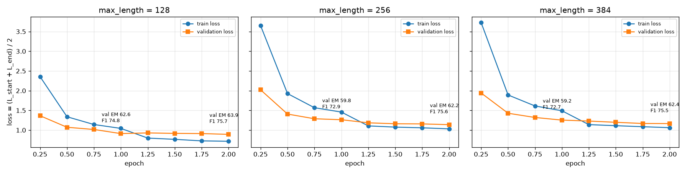
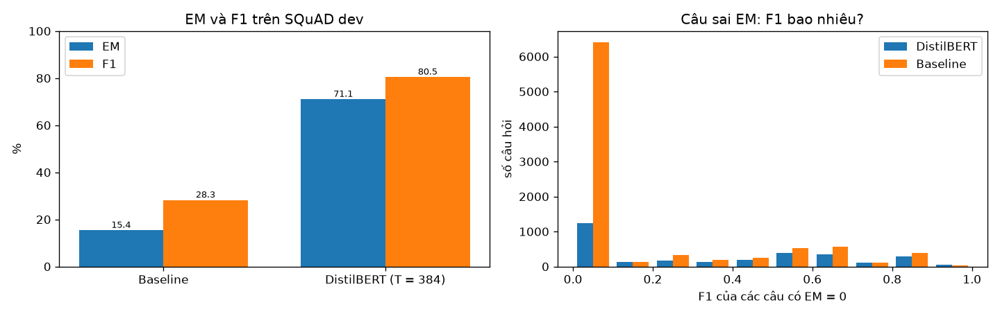
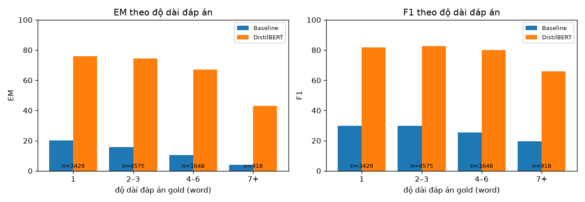

# Reflection — LAB 10

## 1. Kết quả chính (SQuAD v1.1 dev, 10 570 câu hỏi)

| Model | EM | F1 | Train time |
|---|---|---|---|
| Baseline (keyword overlap → câu → span) | 15.42 | 28.27 | — (khoảng 4 s cho cả tập test) |
| DistilBERT, max_length 128 | 70.46 | 79.42 | 1 132 s |
| DistilBERT, max_length 256 | 70.77 | 80.17 | 843 s |
| **DistilBERT, max_length 384** | **71.07** | **80.49** | 950 s |

Cả ba model DistilBERT train trên 30 000 câu hỏi (34% SQuAD train), 2 epoch.

## 2. Đối chiếu prediction

| Prediction | Dự đoán | Thực tế | Đúng? |
|---|---|---|---|
| P1: context có nhiều từ giống câu hỏi | dễ nhầm; baseline nặng hơn; EM giảm 5–10 điểm khi có câu "giống câu hỏi" | Theo mức trùng từ: DistilBERT F1 86.7 (trùng nhiều) so với 72.5 (trùng ít); baseline 38.5 so với 15.3. Với distractor: F1 giảm 58 điểm | Đúng hướng; mức độ lớn hơn nhiều so với dự đoán |
| P2: đáp án dài khó hơn | EM 1 > 2–3 > 4–6 > 7+; 7+ còn khoảng một nửa; lỗi end nhiều hơn start | EM 75.8 / 74.6 / 67.1 / 43.1 (7+ chỉ còn 57% của nhóm 1 word); F1 giảm ít hơn (81.8 → 65.8). Nhưng wrong start (759) **nhiều hơn** wrong end (669) | Đúng về độ dài; sai về start / end |
| P3: thông tin không liên quan / distractor | không liên quan: giảm < 2 F1; distractor: giảm 15–30 F1 | không liên quan: −1.5 F1; distractor: **−58.2 F1**, 70.5% trả lời bằng đáp án giả | Đúng hướng; distractor tệ hơn nhiều so với dự đoán |
| P4: đổi thứ tự câu | giảm 1–3 điểm | −1.9 EM, −1.5 F1; 84.4% dự đoán giữ nguyên | Đúng |

## 3. Trả lời câu hỏi các experiment

### Exp 1 — Context length

| Max length | Stride | Train features | % window không chứa đáp án | EM | F1 | Training time |
|---|---|---|---|---|---|---|
| 128 | 64 | 72 988 | 42.7% | 70.46 | 79.42 | 1 132 s |
| 256 | 128 | 33 362 | 7.0% | 70.77 | 80.17 | 843 s |
| 384 | 128 | 30 319 | 0.9% | **71.07** | **80.49** | 950 s |

**Tăng context length có luôn cải thiện QA không? Không đáng kể, và không phải vì lý do "đọc được nhiều hơn".**

- **Quan sát:** từ 128 lên 384, EM chỉ tăng 0.6 điểm và F1 tăng 1.1 điểm. Validation thì gần như không đổi (F1 75.70 / 75.58 / 75.48, 128 còn nhỉnh nhất).
- **Bằng chứng:** nhờ sliding window, 100% câu hỏi ở mọi T đều có ít nhất một window chứa trọn đáp án (`tokenizer_alignment.ipynb`). T nhỏ không làm mất đáp án, chỉ chia context thành nhiều mảnh hơn (2.43 window / câu ở T = 128 so với 1.01 ở T = 384).
- **Diễn giải:**
  - Phần lớn câu hỏi SQuAD chỉ cần **một câu** của context, và 128 token đã đủ chứa câu đó cùng vài câu xung quanh. Phần tăng nhỏ ở T lớn đến từ các câu hỏi cần nối thông tin xa, và từ việc so điểm giữa các window (T nhỏ có nhiều window, nhiều cơ hội chọn nhầm span ở window không liên quan).
  - Về chi phí, T nhỏ **không rẻ hơn**: T = 128 có 2.4 lần số feature, train lâu nhất (1 132 s), và 43% window chỉ dạy model trỏ về `[CLS]`. Ngoài ra T = 128 bị bỏ 504 bước vì NaN, so với 7–10 bước ở T lớn hơn, nên kết quả T = 128 có thể bị kéo thấp một chút.
  - T = 256 là điểm cân bằng: nhanh nhất, chỉ kém T = 384 0.3 điểm.
- **Lưu ý:** loss của các T không so trực tiếp được. T = 128 có loss thấp hơn (0.89 so với 1.17) chỉ vì nhiều window có đáp án `[CLS]` rất dễ đoán.

### Exp 2 — Pretrained QA model, learning curves



- Ở cả ba T, train loss và validation loss đều giảm liên tục qua 2 epoch. T = 384: train 3.73 → 1.06, val 1.94 → 1.17.
- Val F1 tăng từ epoch 1 sang 2 (72.69 → 75.48). Epoch 2 tốt nhất ở cả ba T, chưa có dấu hiệu overfit.
- Train loss ở epoch 2 thấp hơn val loss (1.06 so với 1.17), nhưng val loss vẫn còn giảm. Nghĩa là model có thể còn học thêm với nhiều epoch hoặc nhiều dữ liệu hơn (mình chỉ dùng 34% SQuAD train).
- Validation lấy từ 25 bài Wikipedia không có trong train, nên val F1 (75.5) thấp hơn test F1 (80.5). Test có tới 3 đáp án gold mỗi câu, còn validation lấy từ train chỉ có 1, nên test dễ đạt EM / F1 hơn.

### Exp 3 — EM vs F1

| Model | EM | F1 | % EM = 0 nhưng F1 > 0 | % F1 = 0 |
|---|---|---|---|---|
| Baseline | 15.42 | 28.27 | 24.1% | 60.5% |
| DistilBERT (T = 384) | 71.07 | 80.49 | 17.4% | 11.6% |



- **Baseline chọn đúng câu chứa đáp án 77.9%,** nhưng EM chỉ 15.4. Tìm đúng câu là phần dễ (trùng từ là đủ); chọn đúng **span** trong câu mới là phần khó, và đó là chỗ DistilBERT hơn hẳn.
- **Khoảng cách F1 − EM của DistilBERT là 9.4 điểm,** gồm 1 837 câu đúng một phần (5 ví dụ tính tay trong `error_analysis.md`, mục 3).
- **Baseline có F1 > 0 ở 39.5% câu,** nhưng phần lớn chỉ nhờ trùng một hai từ. F1 thưởng cả những dự đoán sai về nghĩa nhưng có chung từ với gold.

### Exp 4 — Question / context matching

| Mức trùng từ (câu hỏi ↔ câu chứa đáp án) | n | Baseline EM / F1 | DistilBERT EM / F1 |
|---|---|---|---|
| thấp (< 0.4) | 3 172 | 6.8 / 15.3 | 62.8 / 72.5 |
| trung bình | 3 911 | 15.9 / 29.6 | 72.0 / 81.5 |
| cao (≥ 0.7) | 3 487 | 22.7 / 38.5 | 77.5 / 86.7 |

- **Cả hai model đều phụ thuộc vào trùng từ.** Baseline gần như chỉ dựa vào trùng từ: F1 giảm 2.5 lần khi trùng ít. DistilBERT cũng giảm 14 điểm F1, tức nó vẫn có "phím tắt" lexical overlap.
- **Nhưng DistilBERT ở nhóm trùng ít (72.5) vẫn cao gần gấp đôi baseline ở nhóm trùng nhiều (38.5).**
- **Bộ 8 cặp câu hỏi tự viết** (cùng một sự kiện, hỏi đúng từ so với diễn đạt lại):
  - DistilBERT đúng 7/8 ở cả hai kiểu, ví dụ "Through which nations does South America's largest river pass?" → "Brazil, Peru and Colombia".
  - Baseline giảm từ 4/8 xuống 2/8 khi diễn đạt lại.
  - Pretrained representation hiểu được "French government" ↔ "capital of France", "started the business" ↔ "founded the company". Đây là điều mà đếm từ không làm được.

### Exp 5 — Answer length

| Độ dài đáp án (word) | n | Baseline EM / F1 | DistilBERT EM / F1 | Độ dài dự đoán / gold |
|---|---|---|---|---|
| 1 | 3 429 | 20.2 / 29.9 | 75.8 / 81.8 | 1.98 / 1.00 |
| 2–3 | 4 575 | 15.9 / 29.8 | 74.6 / 82.6 | 3.02 / 2.37 |
| 4–6 | 1 648 | 10.6 / 25.4 | 67.1 / 80.1 | 4.59 / 4.67 |
| 7+ | 918 | 3.9 / 19.7 | **43.1 / 65.8** | 6.70 / 10.80 |



- **Đúng như Prediction 2:** EM giảm mạnh theo độ dài, nhóm 7+ chỉ còn 43%. F1 giảm chậm hơn nhiều (81.8 → 65.8), vì lệch biên ở đáp án dài chỉ mất một phần nhỏ overlap.
- **Model thiên về độ dài "trung bình".** Với đáp án 1 word, nó trả trung bình 2 word (thừa); với đáp án 7+ word, nó trả 6.7 word (thiếu khoảng 4 word). Vì start và end được dự đoán độc lập, model không có khái niệm "đáp án này phải dài": nó chọn từng điểm theo dấu hiệu cục bộ. Đáp án dài thường là mệnh đề hoặc danh sách, nên end hay dừng sớm ở dấu phẩy đầu tiên.

### Context không liên quan, distractor, đổi thứ tự (1 000 câu hỏi test)

| Context | DistilBERT EM / F1 | Baseline EM / F1 | % dự đoán giữ nguyên | % chọn đáp án giả |
|---|---|---|---|---|
| gốc | 73.1 / 80.6 | 15.1 / 27.8 | — | — |
| + 3 câu không liên quan | 71.1 / 79.1 | 15.0 / 27.6 | 83.9% | — |
| + 1 câu distractor | **18.7 / 22.4** | 2.7 / 4.3 | 20.6% | **70.5%** (baseline 69.1%) |
| đổi thứ tự câu | 71.2 / 79.1 | 15.0 / 28.1 | 84.4% | — |

- **Thông tin không liên quan và đổi thứ tự** chỉ làm giảm khoảng 1.5 F1. Model không phụ thuộc vị trí câu, và lờ đi câu không chứa từ khóa.
- **Distractor gần như phá hủy model.** Distractor được tạo bằng cách thay từ hỏi trong câu hỏi bằng một đáp án giả, ví dụ "Henry Cavendish appointed Samuel Phillips to man the tiger team…". Nó lặp lại gần như nguyên văn câu hỏi, nên khớp câu hỏi hơn cả câu thật. Model chọn đáp án giả ở 70.5% câu, gần bằng baseline chỉ đếm từ (69.1%).
- **Đây là bằng chứng rõ nhất cho "shortcut learning":** trên SQuAD gốc, "tìm câu trùng câu hỏi nhất rồi lấy cụm có kiểu phù hợp" đủ để đạt F1 80. Khi phím tắt đó bị đánh lừa, model không có cơ chế kiểm tra nào khác.
- **Lưu ý:** distractor tạo tự động nên nhiều câu sai ngữ pháp ("Republic of Kenya country's schools…"). Dù vậy model vẫn bị lừa, nghĩa là nó không kiểm tra cả ngữ pháp hay tính hợp lý của câu.

## 4. Individual learning check

1. **Extractive QA khác classification thế nào?** Classification chọn một nhãn trong một tập cố định cho cả input. Extractive QA chọn một **vị trí** (span) trong chính input: "nhãn" thay đổi theo từng context, và số lựa chọn bằng số cặp (start, end) hợp lệ.
2. **Vì sao QA cần start và end?** Đáp án là một đoạn liền mạch, xác định bởi hai đầu. Một phân phối chỉ chọn được một vị trí. Dự đoán thẳng cả cặp thì có khoảng T² / 2 lớp, còn tách start / end chỉ cần 2T logit.
3. **Character offset khác token index thế nào?** Character offset đếm ký tự trong chuỗi gốc ("Paris" bắt đầu ở ký tự 25). Token index đếm token trong input của model, gồm cả `[CLS]`, câu hỏi, `[SEP]` ("Paris" là token 14). Một word có thể là nhiều token ("Wozniak" là 4 token).
4. **Vì sao cần offset mapping?** SQuAD cho đáp án theo ký tự, model làm việc theo token. Offset mapping cho biết mỗi token ứng với đoạn ký tự nào. Nhờ đó ta chuyển gold sang nhãn start / end token khi train, và cắt đúng text gốc khi dự đoán (giữ chữ hoa, dấu câu, không ghép lại từ các mảnh `##`).
5. **stride dùng để làm gì?** Là số token context chồng lấn giữa hai window liên tiếp. Nhờ đó một đáp án bị cắt ở cuối window này vẫn nằm trọn trong window sau.
6. **Vì sao context dài phải chia thành nhiều window?** Model có giới hạn độ dài (512 với DistilBERT, và mình đặt 384 vì chi phí attention O(T²)). Context dài hơn bị cắt sẽ mất phần sau. Chia window giữ được toàn bộ context; khi dự đoán, lấy span có điểm cao nhất trên mọi window.
7. **Exact Match đo gì?** Tỉ lệ câu mà đáp án dự đoán trùng **chính xác** với một đáp án gold, sau khi chuẩn hóa (chữ thường, bỏ dấu câu, bỏ a / an / the).
8. **F1 của QA khác accuracy thế nào?** Accuracy (hay EM) chấm đúng / sai cả câu trả lời. F1 chấm theo **mức trùng token** giữa dự đoán và gold: P = trùng / số token dự đoán, R = trùng / số token gold. Dự đoán đúng một phần vẫn được điểm một phần.
9. **Vì sao có F1 > 0 nhưng EM = 0?** Khi dự đoán chồng lấn một phần với gold: thừa hoặc thiếu vài từ ("Tuesday afternoon" so với "Tuesday", F1 0.67), hoặc sai hẳn nhưng tình cờ chung một từ ("The Day of the Doctor" so với "the Eleventh Doctor", F1 0.40).
10. **Wrong start và wrong end khác nhau thế nào?** Wrong start: end đúng, đầu đáp án lệch (thừa hoặc thiếu phần bổ nghĩa đứng trước, ví dụ "over 14,000" → "14,000"). Wrong end: start đúng, đuôi lệch (thiếu đơn vị, kéo qua dấu phẩy). Ở đây wrong start nhiều hơn (759 so với 669), vì các từ chỉ mức độ ở đầu đáp án được gán nhãn không nhất quán.
11. **Extractive QA khác RAG ở đâu?** Extractive QA giả định context **đã có sẵn** và chỉ trích một đoạn trong đó. RAG phải tự **tìm** tài liệu liên quan trong một kho lớn (retrieval), rồi **sinh** câu trả lời (có thể diễn đạt lại, tổng hợp nhiều đoạn).
12. **Khi nào extractive QA không trả lời được?**
    - Khi đáp án không có trong context. Model vẫn buộc phải trả về một span: "LAB 10" cho câu hỏi về tên phòng học.
    - Khi đáp án cần tổng hợp hoặc suy luận, không phải một đoạn liền mạch (đếm, so sánh, yes / no, câu hỏi toán).
    - Khi đáp án nằm rải ở nhiều đoạn.

## 5. Reflection — LAB 08, 09 và 10 dùng cùng pretrained Transformer cho ba bài toán khác nhau như thế nào?

```
                         Pretrained Transformer (DistilBERT / BERT)
                                         │
                          H ∈ ℝ^(T × 768): contextual representation
                 ┌───────────────────────┼─────────────────────────┐
                 ↓                       ↓                         ↓
          h[CLS] (1 vector)       mọi token (T vector)      mọi token (T vector)
                 ↓                       ↓                         ↓
          Linear(768, 2)          Linear(768, 9)            Linear(768, 2)
                 ↓                       ↓                         ↓
       1 nhãn cho cả câu        1 nhãn BIO / token       P_start, P_end trên T vị trí
     (sentiment, LAB 08)        (NER, LAB 09)            (span QA, LAB 10)
```

Ba lab dùng cùng một loại backbone, và phần học từ pretraining (hàng chục triệu tham số) giống hệt nhau. Thứ thay đổi chỉ là một lớp Linear rất nhỏ ở trên cùng, và quan trọng hơn là **cách định nghĩa target**:

- **LAB 08:** chỉ đọc vector `[CLS]` để cho một nhãn. Target là một số 0 / 1, loss là một cross-entropy trên 2 lớp.
- **LAB 09:** đọc **mọi** vector token, cùng một Linear cho mỗi token ra 9 logit. Target là một chuỗi nhãn, loss là trung bình trên các token có nhãn.
- **LAB 10:** cũng đọc mọi token, nhưng Linear chỉ cho 2 số mỗi token. Cột thứ nhất qua softmax **theo chiều vị trí** (không phải theo chiều lớp) thành P<sub>start</sub>; cột thứ hai thành P<sub>end</sub>. Target là hai chỉ số vị trí, loss là trung bình của hai cross-entropy.

Điểm khác tinh tế giữa LAB 09 và LAB 10 là chiều của softmax. NER hỏi "token này thuộc lớp nào?" (softmax trên 9 lớp, cho mỗi token). QA hỏi "vị trí nào là đầu đáp án?" (softmax trên T vị trí, cho cả input). Head gần như giống hệt nhau, chỉ khác cách đọc ra.

Vì sao một backbone làm được cả ba? Vì pretraining (MLM) buộc mỗi vector token phải chứa thông tin về chính nó **trong ngữ cảnh cả câu**. Vector đó đủ để biết cả câu khen hay chê (LAB 08), từ này là tên người hay tên đội bóng (LAB 09), và token này có phải chỗ bắt đầu câu trả lời cho câu hỏi đang được ghép phía trước không (LAB 10). Ở LAB 10, câu hỏi và context nằm chung một input, nên self-attention cho mỗi token context "nhìn thấy" câu hỏi. Đây chính là tương tác question / context mà baseline đếm từ không có: F1 80.5 so với 28.3.

Nhưng LAB 10 cũng cho thấy giới hạn của việc "chỉ đổi head".

- Model đạt F1 80 trên SQuAD, rồi rơi xuống 22 chỉ vì một câu distractor chép lại câu hỏi. Head mới học được *cách đọc ra* vị trí; còn chọn vị trí nào thì nó dựa nhiều vào phím tắt trùng từ có sẵn trong dữ liệu.
- Head cũng định nghĩa luôn giới hạn của bài toán. Extractive QA không thể nói "không có đáp án", không thể tổng hợp hai đoạn, và cần context được đưa sẵn.

Cả ba lab vì vậy là cùng một ý: backbone tạo representation, còn target quyết định bài toán, và cũng quyết định những gì model không bao giờ làm được.

## 6. Bridge to LAB 11

Ở LAB 10, context luôn được đưa sẵn. Document QA với 3 tài liệu cho thấy bước tiếp theo: khi hỏi trên nhiều tài liệu, mình phải chạy model trên **từng** tài liệu rồi so score. Cách này đã tốn với 3 tài liệu, và không thể làm được với 10 000 tài liệu.

Score của span cũng chỉ phản ánh "câu hỏi khớp đoạn nào", nên một tài liệu không liên quan nhưng có câu trùng từ (như distractor) có thể thắng.

LAB 11 sẽ tách bước tìm tài liệu ra: biểu diễn câu hỏi và tài liệu thành vector, rồi tìm top-K tài liệu gần nhất. Chỉ những tài liệu đó mới được đưa vào reader như ở lab này.
