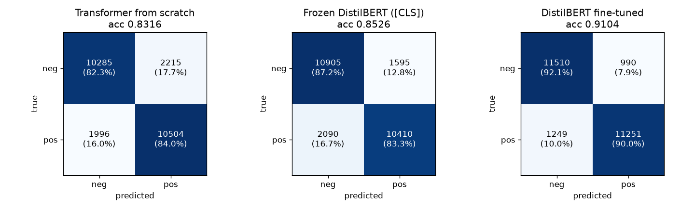
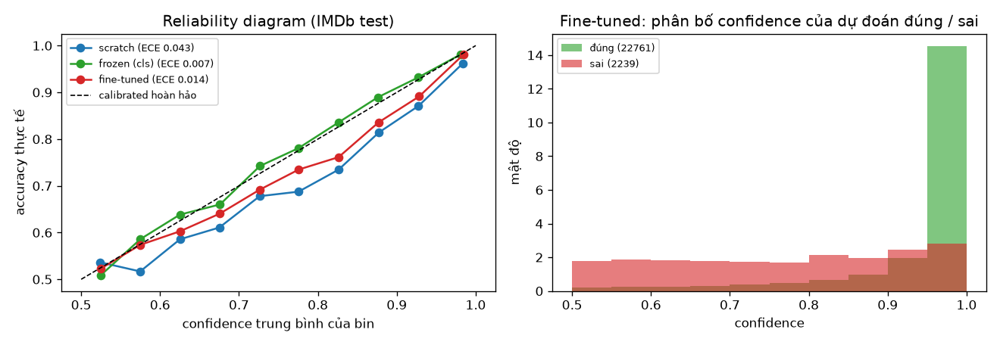

# Error analysis — LAB 08

Model: DistilBERT fine-tuned (seed 42, T = 256, chọn epoch 1 theo validation loss). Đánh giá trên IMDb test (25 000 review). Số `#` là chỉ số dòng trong tập test.

## 1. Kết quả và confusion matrix

| Model | Accuracy | Precision | Recall | F1 |
|---|---|---|---|---|
| Transformer from scratch | 0.8316 | 0.8259 | 0.8403 | 0.8330 |
| Frozen DistilBERT ([CLS]) | 0.8526 | 0.8671 | 0.8328 | 0.8496 |
| Frozen DistilBERT (mean) | 0.8586 | 0.8730 | 0.8394 | 0.8559 |
| **DistilBERT fine-tuned** | **0.9104** | **0.9191** | 0.9001 | **0.9095** |

Confusion matrix của model fine-tuned:

| | pred neg | pred pos |
|---|---|---|
| **true neg** | 11 510 (TN) | 990 (FP) |
| **true pos** | 1 249 (FN) | 11 251 (TP) |

- **Có 2 239 lỗi; FN nhiều hơn FP (1 249 so với 990).** Model hơi thiên về đoán negative: precision 0.919 > recall 0.900. Review khen nhưng có đoạn chê dài dễ bị đoán negative (xem mục 3).
- **Lỗi phụ thuộc rõ vào độ dài:**
  - review dài hơn 256 token (41% tập test) bị cắt và có tỉ lệ lỗi 12.4%, gấp đôi review không bị cắt (6.7%);
  - theo quartile độ dài, accuracy lần lượt là 0.931 / 0.937 / 0.917 / **0.857** (quartile dài nhất, median 510 token).
- **Lỗi của hai model trùng một phần:** trong 2 239 lỗi của model fine-tuned, model from scratch cũng sai 57.8%. 1 295 review cả hai đều sai; đây là các review khó thật hoặc bị gán nhãn sai.

## 2. Câu tự viết (application)

| Câu | P(pos) scratch | P(pos) fine-tuned | Nhận xét |
|---|---|---|---|
| This movie was absolutely wonderful, I loved every minute. | 1.000 | 0.996 | cả hai đúng |
| Not bad at all, actually one of the better films this year. | **0.021** | 0.942 | **negation**: scratch thấy "bad" là đoán negative; fine-tuned hiểu "not bad" |
| I expected to hate it, but it turned out to be great. | 0.998 | 0.940 | cả hai đúng |
| It was great... if you enjoy falling asleep. | 0.996 | 0.973 | **sarcasm**: cả hai sai, tin vào "great" |
| The acting was fine but the plot made no sense whatsoever. | 0.001 | 0.009 | cả hai đúng (negative) |
| A masterpiece of boredom. | 0.995 | 0.853 | sarcasm: cả hai sai; fine-tuned bớt tự tin hơn |
| Oh great, another two hours of my life I will never get back. | 0.999 | 0.712 | sarcasm: cả hai sai; fine-tuned gần ngưỡng |
| The food was cold and the waiter was rude. | 0.237 | 0.045 | domain khác (nhà hàng): fine-tuned chắc chắn hơn |
| Battery life is excellent and it charges quickly. | 1.000 | 0.943 | domain khác (sản phẩm): cả hai đúng |
| Phim rất hay, diễn viên đóng tuyệt vời. | 0.966 | 0.647 | tiếng Việt: tokenizer bỏ dấu, fine-tuned không chắc |

Pretraining giúp rõ nhất ở **negation** ("not bad"), vì nghĩa phụ thuộc ngữ cảnh. Với **sarcasm** thì cả hai đều sai: từ tích cực bề mặt vẫn thắng. Dù vậy, model fine-tuned ít tự tin hơn (0.71–0.85 so với 0.995–0.999).

## 3. Các mẫu sai

| # | Text (rút gọn) | True | Pred | Confidence | Error type | Hypothesis |
|---|---|---|---|---|---|---|
| **FP** 4116 | "…he will never win an Oscar… the geography was wrong… However, there are worse ways to spend an hour and a half. So grab your Doritos… and enjoy a trip back in time." | neg | pos | 0.655 | ambiguous sentiment | Câu kết mang giọng khuyên xem ("enjoy"), nên nhãn negative chỉ dựa vào phần chê ở giữa. Bản thân review lưng chừng, model không chắc (0.66). |
| **FP** 10188 | "John Wayne is without a doubt one of the most popular and loved actors… films hailed as some of his best, unlike this 1934 effort… nothing memorable…" | neg | pos | 0.889 | long-range + truncation | Mở đầu là một đoạn dài khen John Wayne. Phần chê phim chỉ có một mệnh đề "unlike…", và review 512 token nên phần kết luận ở nửa sau bị cắt mất ở T = 256. |
| **FP** 11985 | "Go to the video store and get the original… 'Mostly Martha' has a much better cast… convinced me much more…" | neg | pos | 0.656 | context (so sánh) | Lời khen dành cho phim gốc, không phải phim đang review. Model gom lời khen mà không xác định được nó nói về đối tượng nào. |
| **FP** 8793 | "…this drama is a bit comedic… change that to zany. Not being a MacDowell fan… albeit I enjoyed the film and it is not a total waste." | neg | pos | 0.869 | label ambiguity | Người viết nói "I enjoyed the film". Nhãn negative (rating ≤ 4) mâu thuẫn với nội dung chữ. |
| **FN** 16685 | "Gary Busey saved this film… would have been sub par. I recommend the film but just barely. The biggest difficulty… broad disregard for historical… accuracy. Why is… Why are…" | pos | neg | 0.977 | ambiguous sentiment | Có 1 câu khen và khoảng 8 câu hỏi chất vấn liên tiếp. Model đếm phần chê chiếm đa số, trong khi kết luận ("I recommend") là tích cực. |
| **FN** 19513 | "…entertainingly atrocious nickel'n'dime shot-on-video clunker… hilariously horrendous hoot… gloriously gross'n'graphic gore." | pos | neg | 0.815 | domain-specific expression | Kiểu review phim "so bad it's good": từ chê ("atrocious", "horrendous") được dùng để khen. Từ ngữ này đặc thù của fan phim kinh dị hạng B. |
| **FN** 23886 | "if you are dating a girl that is into wicca! many parts of this movie were killer… but some things really bothered me… you really need to be on a lot of drugs to get just what is going on" | pos | neg | 0.538 | ambiguous sentiment + informal | Viết không dấu câu, khen và chê đan xen. "killer" là từ lóng mang nghĩa tốt. Model gần ngưỡng (0.54). |
| **FN** 19636 | "…could be one of the most gretatest films in tne mexican movie history… sordidness, black humor… incestual…" | pos | neg | 0.543 | rare word / tokenization | Lỗi chính tả "gretatest", "tne" bị cắt thành mảnh vụn. Nhiều từ mô tả nội dung u ám ("sordidness", "violence") dễ bị hiểu là đang chê. |
| **Tự tin, sai** 12061 | "This movie was pure genius… hilarious… I give it 9.5/10. Rent it today!" | neg | pos | 0.996 | label ambiguity (label noise) | Review khen rõ ràng và tự cho 9.5/10, nhưng nhãn lại là negative. Model đúng, nhãn sai. Review này cũng là lỗi tự tin nhất ở LAB 07. |
| **Tự tin, sai** 4118 | "This is definitely one of the best Kung fu movies in the history of Cinema… The final fight… is a masterpiece!" | neg | pos | 0.996 | label ambiguity (label noise) | Không có câu chê nào, gần như chắc chắn là gán nhãn sai. |
| **Tự tin, sai** 2688 | "I really liked this quirky movie… captivating story line… fun to watch." | neg | pos | 0.995 | label ambiguity (label noise) | Tương tự: toàn bộ là khen. |
| **Tự tin, sai** 19650 | "…it was MUCH worse. First of all, there's the music. It's just plain awful… On the other hand, Bill Murray is spot on brilliant… turning a weak script into comic genius." | pos | neg | 0.995 | long-range + truncation | Nửa đầu chê nhạc rất nặng; lời khen Bill Murray và kết luận nằm ở nửa sau. Review dài 512 token, bị cắt ở T = 256 nên model không thấy phần kết. |

### Phân loại nguyên nhân

| Nhóm lỗi | Mẫu | Ghi chú |
|---|---|---|
| Label ambiguity / label noise | 12061, 4118, 2688, 8793 | 3 trên 4 lỗi tự tin nhất là review khen rõ ràng nhưng mang nhãn negative. Ở đây model không sai. |
| Long-range dependency + truncation | 10188, 19650 | Kết luận nằm sau token 256. Tỉ lệ lỗi của review bị cắt gấp đôi review không bị cắt. |
| Ambiguous / mixed sentiment | 4116, 16685, 23886 | Review vừa khen vừa chê, nhãn dựa vào điểm số chứ không dựa vào số câu khen / chê. |
| Context (đối tượng được khen) | 11985 | Khen phim khác để chê phim đang review. |
| Domain-specific expression / sarcasm | 19513 (+ các câu sarcasm ở mục 2) | Từ chê dùng với nghĩa khen. |
| Rare word / tokenization | 19636 | Lỗi chính tả bị cắt thành subword vô nghĩa. |

Không có lỗi nào do **negation** đơn giản. Model fine-tuned xử lý đúng "not bad", "not a total waste", trong khi model from scratch sai ở "Not bad at all".

## 4. Confidence analysis

`confidence = max(softmax(logits))`. Ba nhóm: High ≥ 0.95, Medium 0.75–0.95, Low < 0.75.

| Model | Nhóm | % mẫu | Accuracy | Confidence TB | % tổng lỗi |
|---|---|---|---|---|---|
| Fine-tuned (ECE 0.014) | High | 67.4% | **0.981** | 0.985 | 14.2% (317 lỗi) |
| | Medium | 22.2% | 0.835 | 0.878 | 40.9% |
| | Low | 10.4% | 0.614 | 0.635 | 44.9% |
| From scratch (ECE 0.043) | High | 45.8% | 0.962 | 0.984 | 10.4% |
| | Medium | 33.7% | 0.801 | 0.871 | 39.8% |
| | Low | 20.5% | 0.591 | 0.632 | 49.8% |
| Frozen [CLS] (ECE 0.007) | High | 35.0% | 0.981 | 0.981 | 4.6% |
| | Medium | 40.2% | 0.877 | 0.869 | 33.6% |
| | Low | 24.8% | 0.632 | 0.630 | 61.9% |

**Confidence cao có đồng nghĩa với prediction đúng không? Không.**

- **Quan sát:** nhóm High đúng 98.1%, nhưng vẫn có 317 lỗi, tức 14.2% tổng số lỗi. 1.2% số lỗi có confidence > 0.99.
- **Bằng chứng:** 4 lỗi tự tin nhất (≥ 0.995) gồm 3 review gán nhãn sai và 1 review mà phần kết luận bị cắt mất. Model "chắc chắn" dựa trên phần văn bản nó nhìn thấy; nó không biết phần bị cắt hay nhãn sai.
- **Diễn giải:**
  - Confidence chỉ phản ánh mức nhất quán của tín hiệu trong input. Nó không đo được thông tin bị thiếu (truncation) hay lỗi của nhãn.
  - Trên toàn tập, model fine-tuned khá calibrated (ECE 0.014): accuracy từng nhóm gần bằng confidence trung bình. Model from scratch tự tin quá mức (nhóm Medium có confidence 0.871 nhưng chỉ đúng 0.801).
  - Frozen calibrated tốt nhất (ECE 0.007) nhưng ít khi tự tin: chỉ 35% mẫu nằm trong nhóm High.
  - Trên domain khác, confidence trung bình của model fine-tuned vẫn khoảng 0.90–0.92 (Exp 5). Tức confidence không báo hiệu khi dữ liệu thay đổi domain.
