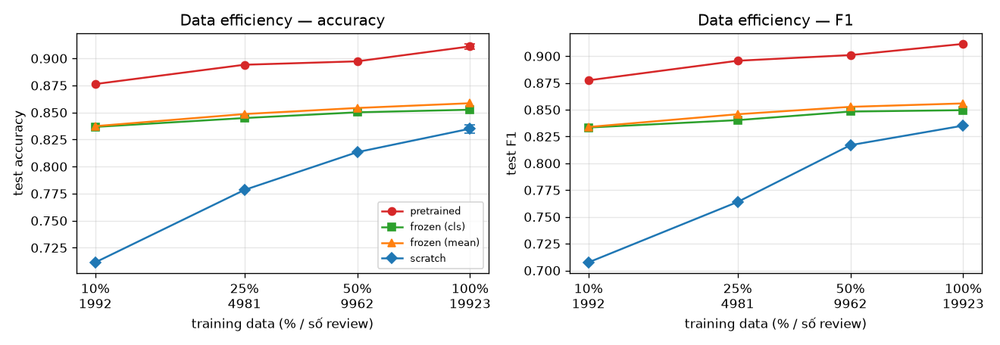
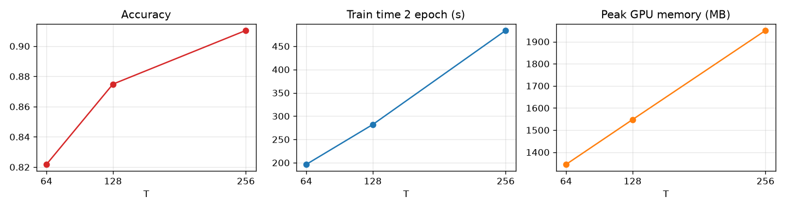

# Reflection — LAB 08

## 1. Kết quả chính (IMDb test, 25 000 review)

| Model | Accuracy | F1 | Training time | # Parameters (train được) |
|---|---|---|---|---|
| Transformer from scratch (3 seed) | 0.835 ± 0.004 | 0.835 ± 0.003 | 33 s | 4 039 554 |
| Frozen DistilBERT + head ([CLS]) | 0.853 | 0.850 | 290 s* | 1 538 |
| Frozen DistilBERT + head (mean) | 0.859 | 0.856 | 289 s* | 1 538 |
| **DistilBERT fine-tuned (3 seed)** | **0.911 ± 0.002** | **0.911 ± 0.002** | 484 s | 66 364 418 |

\* Gần như toàn bộ là thời gian chạy encoder một lần để lấy feature (train 223 s + val 56 s); train head chỉ mất khoảng 10 s.

## 2. Đối chiếu prediction

| Prediction | Dự đoán | Thực tế | Đúng? |
|---|---|---|---|
| P1: pretrained > scratch | 0.90–0.92 so với 0.83–0.85, chênh ≥ 5 điểm | 0.911 so với 0.835 (chênh 7.6 điểm); val loss epoch 1 đã là 0.238, thấp hơn mức tốt nhất của scratch (0.37) | Đúng |
| P2: frozen | C. kém hơn, khoảng 0.80–0.85 | 0.853 / 0.859, kém fine-tuning 5–6 điểm | Đúng |
| P3: 10% data | scratch giảm mạnh hơn | scratch giảm 12.4 điểm, pretrained 3.5 điểm | Đúng; pretrained ở 10% (0.876) cao hơn mức dự đoán |
| Phụ: max length | tăng theo T, mức tăng nhỏ dần | 0.822 → 0.875 → 0.910: mức tăng **không** nhỏ dần nhiều (+5.3 rồi +3.5) | Một phần |
| Phụ: domain shift | giảm còn 0.85–0.88 | **không giảm**: Amazon 0.927, Yelp 0.924, cao hơn IMDb 0.910. Model scratch giảm 3.6–4.7 điểm | Sai với pretrained |

Prediction về domain shift sai vì mình chỉ nghĩ tới chênh lệch từ vựng. Mình bỏ qua hai yếu tố khác:

- Review Yelp và Amazon **ngắn** (median 125 và 94 token), nên không bị cắt ở T = 256. Trên IMDb, 41% review bị cắt.
- Review Yelp và Amazon nói cảm xúc **trực tiếp hơn** review phim, vốn hay kể lại cốt truyện.

## 3. Trả lời câu hỏi các experiment

### Exp 1 — Pretrained vs from scratch

1. **Representation:**
   - Model from scratch học embedding và attention chỉ từ 20 000 review. Mỗi token chỉ là "dấu hiệu tích cực hay tiêu cực" của IMDb, không có nghĩa nào khác.
   - DistilBERT mang theo contextual representation học từ corpus lớn. Cùng một token có vector khác nhau tùy ngữ cảnh. Vì vậy nó xử lý đúng "Not bad at all" (0.94), trong khi model from scratch cho 0.02.
2. **Training data:**
   - Model from scratch cần nhiều dữ liệu, vì phải học cả nghĩa từ.
   - Pretrained chỉ cần học ánh xạ sang nhãn. Bằng chứng: chỉ với 10% data (1 992 review), pretrained đạt 0.876, cao hơn model from scratch dùng 100% data (0.835).
3. **Chi phí tính toán:**
   - Pretrained lớn hơn 16 lần (66.4 triệu tham số so với 4.0 triệu) và train lâu hơn khoảng 15 lần (484 s so với 33 s).
   - Pretrained dùng 1.95 GB VRAM, so với 0.16 GB. Dự đoán trên 25 000 review cũng chậm hơn nhiều.
   - Phần chi phí lớn nhất, tức pretraining, đã có người khác trả trước.
4. **Khớp prediction:** có (xem bảng mục 2).

### Exp 2 — Frozen vs fine-tuning

| Mode | Encoder trainable? | Accuracy | F1 | Training time |
|---|---|---|---|---|
| Frozen ([CLS]) | No | 0.853 | 0.850 | 290 s |
| Frozen (mean) | No | 0.859 | 0.856 | 289 s |
| Fine-tuning | Yes | 0.911 | 0.911 | 484 s |

- **Vì sao frozen vẫn phân loại được:**
  - Pretraining bằng MLM buộc encoder phải mã hóa nghĩa của câu, và sentiment là một phần của nghĩa đó. Ở `tokenization.ipynb`, model MLM chưa từng train sentiment vẫn điền "amazing" sau "I loved every minute" và "boring" sau "I walked out".
  - Chỉ với 1 538 tham số (một Linear), frozen đã vượt model from scratch 4 triệu tham số.
- **Vì sao fine-tuning tốt hơn:**
  - Representation của encoder frozen được tối ưu cho MLM, không phải cho sentiment. Thông tin sentiment có trong đó nhưng không tách được hoàn toàn bằng một siêu phẳng tuyến tính.
  - Fine-tuning điều chỉnh mọi layer để dồn thông tin sentiment vào vector [CLS]. Với DistilBERT (không có pretraining NSP), vector [CLS] chưa từng được train để tóm tắt câu, vì vậy frozen [CLS] kém frozen mean một chút.

### Exp 3 — Lượng training data

| Training data | Pretrained acc / F1 | Frozen (mean) acc | Scratch acc / F1 |
|---|---|---|---|
| 10% (1 992) | 0.876 / 0.877 | 0.837 | 0.712 / 0.708 |
| 25% (4 981) | 0.894 / 0.896 | 0.849 | 0.778 / 0.764 |
| 50% (9 962) | 0.897 / 0.901 | 0.854 | 0.813 / 0.817 |
| 100% (19 923) | 0.911 / 0.911 | 0.859 | 0.835 / 0.835 |

**Pretraining có giúp dùng dữ liệu downstream hiệu quả hơn không? Có.** Kết luận này dựa trên cả đường cong, không phải một điểm:

- Ở **mọi** mức data, pretrained luôn cao hơn scratch. Khoảng cách lớn nhất ở 10% (16.5 điểm) và thu hẹp dần: 11.6 → 8.4 → 7.6 điểm.
- Đường của pretrained **phẳng**: từ 10% lên 100% chỉ tăng 3.5 điểm. Đường của scratch **dốc** (+12.4 điểm) và vẫn chưa bão hòa ở 100%.
- Frozen phẳng nhất (+2.1 điểm), vì chỉ học 1 538 tham số. Thêm data không giúp được nhiều khi representation cố định.

Lưu ý: các điểm 10–50% chỉ chạy 1 seed. Độ lệch giữa 3 seed ở 100% là ±0.002 (pretrained) và ±0.004 (scratch), nhỏ hơn nhiều so với các khoảng cách trên.

### Exp 4 — Max sequence length

| Max length | Accuracy | F1 | Training time (2 epoch) | Peak GPU memory | % review bị cắt |
|---|---|---|---|---|---|
| 64 | 0.822 | 0.821 | 196 s | 1 345 MB | 97.9% |
| 128 | 0.875 | 0.874 | 282 s | 1 548 MB | 87.8% |
| 256 | 0.910 | 0.910 | 484 s | 1 951 MB | 41.2% |

**Tăng sequence length có luôn làm model tốt hơn không? Không.**

- Ở đây tăng T giúp nhiều, vì review IMDb dài (median 221 token): T = 64 chỉ thấy khoảng 1/4 review. Kết luận này phụ thuộc vào độ dài dữ liệu.
- Với Yelp hay Amazon (median 94–125 token), tăng T quá 128 gần như không có thêm thông tin, chỉ thêm chi phí.
- Chi phí tăng **chậm hơn** T²: T × 4 thì thời gian × 2.5 và bộ nhớ × 1.45.
  - Ở T ≤ 256, phần tuyến tính theo T (FFN, các phép chiếu Q/K/V, embedding) vẫn chiếm phần lớn.
  - Phần O(T²) của attention mới chỉ bắt đầu lộ ra. LAB 07 đã cho thấy ở T ≥ 512 nó chiếm ưu thế: T = 1 024 vượt 4 GB VRAM.
- DistilBERT còn bị giới hạn cứng ở 512 token (position embedding học sẵn), nên muốn đọc cả review dài cũng không được.

### Exp 5 — Domain shift

| Model | IMDb (in-domain) | Amazon | Yelp |
|---|---|---|---|
| Scratch | 0.832 | 0.785 (−4.7) | 0.796 (−3.6) |
| Frozen ([CLS]) | 0.853 | 0.874 (+2.1) | 0.875 (+2.2) |
| Frozen (mean) | 0.859 | 0.860 (+0.1) | 0.857 (−0.2) |
| Fine-tuned | 0.910 | 0.927 (+1.6) | 0.924 (+1.3) |

**Pretrained model có "hiểu mọi domain" không? Không, và kết quả này không chứng minh điều đó.**

- **Quan sát:** model fine-tuned không giảm trên Yelp và Amazon, còn model from scratch giảm 3.6–4.7 điểm.
- **Bằng chứng:**
  - Model from scratch chỉ biết từ vựng IMDb. "food", "waiter", "battery" gần như không có trong dữ liệu train, nên nó chỉ dựa vào vài từ cảm xúc chung.
  - DistilBERT đã thấy các domain này lúc pretrain (Wikipedia, sách).
  - Nhưng Yelp và Amazon là domain **gần** (vẫn là review, cảm xúc nói thẳng) và **dễ hơn** (ngắn, không bị cắt).
- **Diễn giải:**
  - Đây là trường hợp domain shift nhẹ. Nó cho thấy pretraining giúp chống domain shift về **từ vựng**, chứ không cho thấy model hiểu mọi domain.
  - Với domain xa hơn (tin tài chính, văn bản y khoa, tweet nhiều tiếng lóng, tiếng Việt), không có bằng chứng nào ở đây cho thấy model vẫn tốt. Câu tiếng Việt ở mục application chỉ được P = 0.65.
  - Frozen có recall rất cao nhưng precision thấp trên Yelp (0.919 / 0.845), tức là bị lệch về phía positive: ngưỡng quyết định học trên IMDb không còn đúng ở domain mới.

## 4. Câu hỏi bắt buộc (mục 28)

- **Q1. Model nào hưởng lợi nhiều hơn khi data ít?** Pretrained.
  - Ở 10% data, pretrained hơn scratch 16.5 điểm. Ở 100%, khoảng cách chỉ còn 7.6 điểm.
  - Khoảng cách càng lớn khi data càng ít, nghĩa là phần kiến thức pretraining mang lại thay thế được cho dữ liệu downstream.
- **Q2. Pretrained tốt hơn from scratch chứng minh điều gì?**
  - Chứng minh: với **dữ liệu này** (20 000 review) và **ngân sách train này**, khởi tạo từ trọng số pretrained tốt hơn khởi tạo ngẫu nhiên.
  - Không chứng minh model "hiểu ngôn ngữ". Hai model còn khác nhau cả về kích thước (66 triệu so với 4 triệu tham số) và số layer (6 so với 1), nên một phần chênh lệch có thể đến từ dung lượng model.
  - Phép thử frozen tách được hai yếu tố: không train encoder, chỉ 1 538 tham số, vẫn hơn scratch. Như vậy chính representation pretrained là yếu tố quan trọng.
- **Q3. Frozen gần bằng fine-tuned nghĩa là gì?**
  - Nghĩa là representation pretrained đã chứa sẵn gần đủ thông tin cho task, chỉ cần một Linear đọc ra. Khi đó nên dùng frozen: rẻ hơn, không sợ quên kiến thức cũ, và một encoder dùng chung được cho nhiều task.
  - Ở đây khoảng cách là 5–6 điểm, nên không phải trường hợp này.
- **Q4. Fine-tuning tốt hơn frozen nhiều gợi ý điều gì?**
  - Task cần những đặc trưng mà MLM không trực tiếp tạo ra, ví dụ cân nhắc khen và chê trong cả review, hay hiểu "not bad". Encoder cần được điều chỉnh để đưa các đặc trưng này lên bề mặt.
  - Điều đó cũng có nghĩa là các tham số pretrained bị thay đổi. Cần learning rate nhỏ (2e-5) và ít epoch: ở đây val loss đã tăng từ epoch 2 (0.238 → 0.279), dấu hiệu bắt đầu overfit hoặc quên kiến thức cũ.
- **Q5. Performance giảm mạnh trên domain khác có thể do đâu?**
  - Từ vựng và cách nói khác nhau: từ chuyên ngành bị cắt vụn thành subword.
  - Phân phối nhãn hoặc độ dài khác nhau.
  - Cùng một từ mang sentiment khác nhau: "unpredictable" khen phim nhưng chê xe.
  - Ngưỡng 0.5 học trên domain A không còn phù hợp (frozen lệch về positive trên Yelp).
  - Representation pretrained không phủ domain đó: domain chuyên môn hoặc ngôn ngữ khác.
- **Q6. T tăng nhưng performance không đổi trong khi thời gian tăng mạnh: có nên tăng tiếp không?**
  - Không. Phần văn bản thêm vào không mang thông tin mới cho task, trong khi chi phí tăng theo O(T²) về lâu dài.
  - Nên chọn T nhỏ nhất mà accuracy đã bão hòa, dựa trên phân phối độ dài của dữ liệu. Nếu thông tin quan trọng nằm cuối văn bản, có thể giữ cả đầu lẫn cuối (head + tail truncation) thay vì tăng T.
  - Ở IMDb, từ 128 lên 256 vẫn còn tăng 3.5 điểm, nên 256 vẫn đáng.

## 5. Individual learning check

1. **Pretraining khác fine-tuning ở đâu?**
   - Pretraining: train trên corpus rất lớn, không nhãn, với mục tiêu tự giám sát (MLM) để học representation chung.
   - Fine-tuning: bắt đầu từ trọng số pretrained, train tiếp trên dataset có nhãn của một task cụ thể, với learning rate nhỏ.
2. **MLM là gì?** Che ngẫu nhiên khoảng 15% token và bắt model đoán lại từ ngữ cảnh hai phía. Loss là cross-entropy trên các vị trí bị che.
3. **Tại sao cần tokenizer?** Model chỉ nhận số. Tokenizer chuyển text thành token ID theo **đúng** vocabulary lúc pretrain. Dùng sai tokenizer thì ID không khớp với embedding đã học.
4. **Subword giải quyết vấn đề gì?**
   - Vocabulary hữu hạn (30 000) nhưng không còn từ ngoài vocabulary: từ lạ được ghép từ mảnh, ví dụ `un ##watch ##able`.
   - Các từ cùng gốc chia sẻ mảnh, nên chia sẻ được thông tin.
5. **[CLS] dùng thế nào?** Token đặc biệt đặt ở đầu câu. Hidden state cuối của nó (qua self-attention đã nhìn mọi token) được dùng làm vector cho cả câu, rồi đưa vào Linear để phân loại.
6. **Attention mask dùng để làm gì?** Đánh dấu token thật (1) và `[PAD]` (0), để attention không nhìn vào padding. Bỏ mask thì vector [CLS] của cùng một câu đổi 6.68 (trên chuẩn 12.3) chỉ vì có thêm padding.
7. **Frozen encoder là gì?** Giữ nguyên trọng số encoder (`requires_grad = False`) và chỉ train head.
8. **Fine-tuning thay đổi tham số nào?** Toàn bộ: embedding, mọi layer attention và FFN, LayerNorm, cộng với head mới khởi tạo ngẫu nhiên.
9. **Vì sao pretrained hữu ích khi dataset nhỏ?** Phần lớn kiến thức (nghĩa từ, cú pháp, ngữ cảnh) đã có sẵn, nên dữ liệu ít chỉ cần dạy "hướng" của task. Ở 10% data: 0.876 so với 0.712.
10. **Pretrained có đảm bảo không bị domain shift không?** Không. Ở đây model giữ được trên Yelp và Amazon vì hai domain này gần và dễ. Domain xa hoặc ngôn ngữ khác vẫn có thể giảm mạnh, và confidence không báo trước điều đó.
11. **Vì sao tăng T làm chi phí attention tăng?** Mỗi token tính score với mọi token khác, nên ma trận attention có kích thước T × T cho mỗi head và mỗi layer. T tăng gấp đôi thì phần này tăng gấp 4 cả về phép tính lẫn bộ nhớ.
12. **Confidence cao có đảm bảo đúng không?** Không. Nhóm ≥ 0.95 vẫn có 317 lỗi, và 4 lỗi tự tin nhất là do nhãn sai hoặc phần kết luận bị cắt.

## 6. Reflection — Vì sao trong thực tế người ta không train Transformer từ đầu?

LAB 07 cho thấy tự xây một Transformer không khó: vài trăm dòng code, train 30 giây, accuracy 0.835. Nhưng LAB 08 cho thấy con số đó gần như là giới hạn của cách làm này, và lý do không nằm ở kiến trúc mà ở **dữ liệu**.

Model from scratch chỉ biết những gì có trong 20 000 review. Nó phải học cùng lúc nghĩa của 30 000 token và cách dùng chúng để đoán sentiment. Khi giảm xuống 2 000 review, accuracy rơi còn 0.71. Trong khi đó, DistilBERT với cùng 2 000 review vẫn đạt 0.876, cao hơn cả model from scratch dùng toàn bộ dữ liệu. Phần chênh lệch đó là **pretrained representation**: kiến thức về từ, cú pháp và ngữ cảnh mà model đã học từ hàng tỉ token trước khi thấy IMDb. Thí nghiệm frozen cho thấy rõ nhất: không train encoder, chỉ thêm một lớp Linear 1 538 tham số, đã đạt 0.859.

Về **chi phí tính toán**, fine-tuning DistilBERT tốn khoảng 8 phút trên GPU laptop, gấp 15 lần model nhỏ. Đổi lại, phần đắt nhất, tức pretraining trên corpus khổng lồ, đã có người trả. Tự pretrain một model cỡ đó vượt xa khả năng của một sinh viên hay phần lớn công ty. Vì vậy cách làm hợp lý là dùng chung một model pretrained, rồi chỉ fine-tune cho từng **downstream task**. Head phân loại là phần duy nhất gắn với task; đổi task (sentiment, phân loại tin tức, NER) chỉ cần đổi head và dữ liệu nhãn.

**Fine-tuning** cũng không phải cứ train thêm là tốt. Learning rate phải nhỏ (2e-5). Ở đây val loss đã tăng từ epoch 2, và epoch tốt nhất là epoch 1. Train quá nhiều thì model overfit và có thể quên kiến thức pretrained.

Cuối cùng là **giới hạn**:
- Model không đọc được quá 512 token, và lỗi tập trung ở review bị cắt (tỉ lệ lỗi 12.4% so với 6.7%).
- Tokenizer cố định nên làm hỏng tiếng Việt và emoji.
- Model vẫn thua sarcasm.
- Trên Yelp và Amazon model không bị **domain shift**, nhưng đó là domain gần và dễ. Kết quả này không chứng minh model đã "hiểu mọi domain". Confidence trung bình vẫn khoảng 0.90 dù domain đã đổi, nên model cũng không tự báo được khi nó ra khỏi vùng quen thuộc.

Pretrained Transformer vì vậy là điểm xuất phát tốt nhất hiện nay, nhưng vẫn cần đánh giá trên dữ liệu thật của từng ứng dụng.

## 7. Bridge to LAB 09

Classification chỉ cho một nhãn cho cả review. Nhưng representation của DistilBERT có ở **mọi** vị trí token, không chỉ ở [CLS]. LAB 09 sẽ đặt head lên từng token (token classification) để gán nhãn PERSON, LOCATION, … cho NER.

Khi đó subword trở thành vấn đề thực tế: "Schwarzenegger" thành `schwarz ##ene ##gger`, vậy nhãn gán cho mảnh nào? Attention mask và truncation cũng phải xử lý ở mức từng token.
