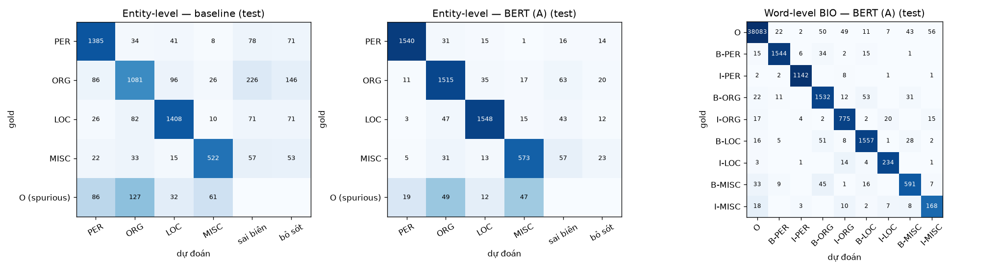

# Error analysis — LAB 09

Model: `bert-base-cased` fine-tuned, Strategy A (subword đầu + IGNORE), CoNLL-2003 test (3 453 câu, 5 648 entity). So sánh với baseline Logistic Regression. Mọi số liệu ở mức entity (khớp đúng biên + loại), lấy từ `ner_finetuning.ipynb`.

## 1. Tổng quan lỗi

Mỗi lỗi entity-level được xếp vào một nhóm:

| Nhóm lỗi | Định nghĩa | BERT (A) | Baseline |
|---|---|---|---|
| spurious entity (FP) | span dự đoán không chồng lên entity gold nào | 127 | 306 |
| missing entity (FN) | entity gold không có span dự đoán nào chồng lên | 69 | 341 |
| wrong type | đúng biên, sai loại | **224** | 479 |
| wrong boundary | chồng lấn, cùng loại, sai biên | 114 | 409 |
| type + boundary | chồng lấn, sai cả hai | 103 | 342 |

Confusion matrix entity-level của BERT (hàng: gold, cột: dự đoán):

| gold \ pred | PER | ORG | LOC | MISC | sai biên | bỏ sót |
|---|---|---|---|---|---|---|
| PER | **1 540** | 31 | 15 | 1 | 16 | 14 |
| ORG | 11 | **1 515** | 35 | 17 | 63 | 20 |
| LOC | 3 | 47 | **1 548** | 15 | 43 | 12 |
| MISC | 5 | 31 | 13 | **573** | 57 | 23 |
| O (spurious) | 19 | 49 | 12 | 47 | — | — |

Quan sát:

- **Lỗi nhiều nhất của BERT là sai loại, không phải bỏ sót.** Model gần như luôn tìm ra *có* một entity: chỉ 69 entity bị bỏ sót hoàn toàn, so với 341 của baseline. Cái khó là quyết định nó *là gì*.
- **Các cặp nhầm loại hay gặp nhất:**
  - LOC → ORG (47) và ORG → LOC (35): tên thành phố dùng làm tên đội thể thao ("Chicago", "Victoria").
  - MISC → ORG (31) và PER → ORG (31).
- **ORG là loại thu hút nhiều lỗi nhất:** 49 span spurious, và nhiều loại khác bị đoán thành ORG.
- **Biên sai theo cả hai chiều:** 62 lần dự đoán ngắn hơn gold, 52 lần dài hơn.
- **Lỗi tập trung ở entity chưa gặp:** 78.2% lỗi rơi vào entity không xuất hiện trong train, trong khi nhóm này chỉ chiếm 47.5% tổng số entity gold.

## 2. Bảng lỗi (BERT A)

Cột "conf" là xác suất nhỏ nhất ở subword đầu của các word trong span. "seen" cho biết chuỗi entity (cùng loại) có trong train hay không.

### 2.1. False positive — spurious entity

| Text (rút gọn) | Gold | Prediction | conf | Error type | Explanation |
|---|---|---|---|---|---|
| "…the idle Green Bay Packers ( 10-3 ) to clinch the first **NFC** playoff berth ." | O | NFC [ORG] | 0.859 | spurious / ambiguous entity | NFC (National Football Conference) là tên một tổ chức, nhưng người gán nhãn để O vì nó đứng trong cụm "NFC playoff berth". Model đúng về nghĩa, sai so với quy ước gán nhãn. |
| "Aninat also said he was confident the Chilean Congress would ratify the treaty with **Congress** quickly ." | O | Congress [ORG] | 0.999 | spurious (label noise) | Lần xuất hiện thứ hai của "Congress" chỉ đúng cùng một tổ chức với lần đầu, nhưng không được gán nhãn. Gần như chắc chắn là gold thiếu nhãn. |
| "SOCCER - ENGLISHMAN CHARLTON IS MADE AN **HONORARY** IRISHMAN ." | O | HONORARY [MISC] | 0.517 | spurious / tokenization (viết hoa) | Tiêu đề viết hoa toàn bộ, nên chữ hoa không còn là tín hiệu tên riêng. "HONORARY" bị tách `H ##ON ##OR ##AR ##Y`, nằm cạnh "IRISHMAN" (MISC), và model không chắc (0.52). |
| "**Mediterranean** oil products were steady to mostly lower on Friday…" | O | Mediterranean [MISC] | 0.790 | spurious / ambiguous entity | "Mediterranean" ở đây là tính từ chỉ khu vực thị trường. Ở chỗ khác trong train nó được gán MISC, nên ranh giới giữa tính từ chỉ địa danh và tên riêng không nhất quán. |
| "…to visit Polish-born **Pope** John Paul in early 1997…" | O | Pope [PER] | 0.883 | spurious / wrong boundary | Theo quy ước CoNLL, chức danh không thuộc entity; gold chỉ có "John Paul". Model coi "Pope" là một PER riêng, đứng trước PER thật. |
| "…the only way to make the **Conservatives** electable in a general election…" | O | Conservatives [ORG] | 0.918 | spurious (label noise) | "Conservatives" là tên đảng (ORG) và có ngữ cảnh rõ ("Member of Parliament", "general election"). Gold để O, khả năng cao là thiếu nhãn. |

### 2.2. False negative — missing entity

| Text (rút gọn) | Gold | Prediction | conf | Error type | Explanation |
|---|---|---|---|---|---|
| "**Association** games on Friday ( home team in CAPS ) :" | Association [ORG] | — | 0.999 | missing / context-dependent | "Association" là viết tắt của giải Football Association, nhưng một mình nó là danh từ chung. Câu là tiêu đề bảng kết quả, gần như không có ngữ cảnh. |
| "CITY OF HARTFORD , **CONNECTICUT**" | CONNECTICUT [LOC] | — | 0.997 | missing / tokenization (viết hoa) | Dòng viết hoa toàn bộ, "CONNECTICUT" bị tách thành nhiều mảnh. Model coi cả dòng là tiêu đề, không phải tên riêng. |
| "RUGBY UNION - RETIRING **CAMPESE** WEIGHS UP OPTIONS ." | CAMPESE [PER] | — | 0.982 | missing / rare entity + viết hoa | Tên cầu thủ hiếm (unseen), đặt trong tiêu đề viết hoa, giữa các từ thường cũng viết hoa ("RETIRING", "WEIGHS"). |
| "NHL ICE HOCKEY - CANUCKS RW **BURE** SUSPENDED FOR ONE GAME ." | BURE [PER] | — | 0.721 | missing / rare entity | Giống trên: tên hiếm, viết hoa, chỉ có tín hiệu từ "RW" (right wing) mà model không biết. |
| "**Major** told parliament on Thursday he would keep his options open…" | Major [PER] | — | 0.939 | missing / ambiguous entity | "Major" (John Major) trùng với tính từ thường "major", lại đứng đầu câu nên chữ hoa không giúp gì. Model chọn nghĩa phổ biến. |
| "Relations between Clarke , **Major** good - spokesman ." | Major [PER] | — | 1.000 | missing / ambiguous entity | Cùng lỗi, nhưng model rất tự tin (1.0) dù "Clarke , Major" là danh sách tên người. |

### 2.3. Boundary error

| Text (rút gọn) | Gold | Prediction | conf | Error type | Explanation |
|---|---|---|---|---|---|
| "GUNMEN WOUND TWO **MANCHESTER UNITED** FANS IN AUSTRIA ." | MANCHESTER UNITED [ORG] | UNITED [ORG] | 0.712 | wrong boundary (ngắn hơn) | Viết hoa toàn bộ, "MANCHESTER" bị tách vụn. Model nhận ra "UNITED" là tên đội nhưng mất từ đầu của entity. |
| "CRICKET - **WEST INDIES** TO BAT AFTER WINNING THE TOSS ." | WEST INDIES [LOC] | INDIES [LOC] | 0.340 | wrong boundary (ngắn hơn) | "WEST" là từ chỉ hướng phổ biến, nên model không coi nó là phần đầu của tên riêng. Confidence rất thấp (0.34) cho thấy model phân vân. Lỗi lặp lại ở câu khác cùng dạng (conf 0.37). |
| "GOLF - THIRD ROUND OF **JCPENNEY CLASSIC** WASHED OUT ." | JCPENNEY CLASSIC [MISC] | JCPENNEY [MISC] | 0.959 | wrong boundary (ngắn hơn) | "CLASSIC" là từ thường. Model coi tên giải chỉ là tên nhà tài trợ. |
| "25-1 **Barcelona** Real Madrid" | Barcelona [ORG] | Barcelona Real Madrid [ORG] | 0.998 | wrong boundary (dài hơn) | Dòng kết quả thể thao không có dấu câu giữa hai đội, nên model gộp hai ORG liền nhau thành một. Đây là nhược điểm của BIO: hai entity cùng loại đứng sát nhau chỉ phân biệt được bằng một nhãn `B` thứ hai. |
| "…receive small presents from **Saint Nicholas** , convinced police…" | Saint Nicholas [PER] | Nicholas [PER] | 0.827 | wrong boundary (ngắn hơn) | Model coi "Saint" là chức danh (như "Pope"), nên bỏ ra khỏi entity. Quy ước ở đây ngược với trường hợp "Pope": tên thánh là một phần của tên. |
| "…a key member of the **1966 World Cup** winning team…" | 1966 World Cup [MISC] | World Cup [MISC] | 0.998 | wrong boundary (ngắn hơn) | Số năm thường không thuộc entity, nhưng ở đây là một phần tên sự kiện. Biên trái phụ thuộc quy ước gán nhãn. |

### 2.4. Sai loại (bổ sung)

| Text (rút gọn) | Gold | Prediction | Error type | Explanation |
|---|---|---|---|---|
| "…the four-day Sheffield Shield cricket match between Tasmania and **Victoria** at Bellerive Oval" | Victoria [ORG] | Victoria [LOC] | wrong type / context-dependent | "Victoria" là bang của Úc nhưng ở đây là đội cricket. Model đoán theo nghĩa phổ biến hơn. |
| "Chicago 0 0" | Chicago [LOC] | Chicago [ORG] | wrong type / context-dependent | Dòng bảng điểm thể thao, nên ORG (tên đội) thực ra là cách hiểu hợp lý; gold LOC đáng nghi. |
| "JosepGuardiola" | JosepGuardiola [PER] | JosepGuardiola [ORG] | wrong type / tokenization | Thiếu dấu cách nên tên người bị tách thành các mảnh lạ; không có ngữ cảnh nào khác. |

## 3. Phân tích theo nguyên nhân

| Nguyên nhân (đề mục 2, ý 11) | Bằng chứng |
|---|---|
| **Tokenization** | Word viết hoa toàn bộ bị tách 87% (`tokenizer_alignment.ipynb`). Các lỗi tiêu đề (CONNECTICUT, MANCHESTER UNITED, CAMPESE, BURE, HONORARY) đều thuộc dạng này. Tuy vậy, trên toàn tập, entity có word bị tách chỉ thấp hơn một chút (F1 0.903 so với 0.920). Subword không phải nguyên nhân chính khi có đủ ngữ cảnh. |
| **Context** | "Victoria", "Chicago", "Santa Fe", "Wimbledon" đổi loại theo ngữ cảnh. Trên 367 lần xuất hiện của 64 surface form mơ hồ, BERT đúng 86.1%, baseline 65.4%. Các dòng bảng điểm ("Chicago 0 0") gần như không có ngữ cảnh, nên vẫn sai. |
| **Entity boundary** | 114 + 103 lỗi có biên sai. Biên sai nhiều nhất khi entity chứa từ thường ("WEST", "CLASSIC", "Saint", "1966") hoặc hai entity đứng sát nhau ("Barcelona Real Madrid"). |
| **Rare entity** | Entity unseen có F1 0.855, entity seen 0.962. Recall theo số lần xuất hiện trong train: 0 lần 0.870 → 1–2 lần 0.911 → 3–10 lần 0.953 → > 10 lần 0.981. |
| **Domain shift** | Trong CoNLL đã có hai "domain": văn bản tin tức thường và bảng kết quả thể thao / tiêu đề viết hoa. Phần lớn lỗi của BERT rơi vào loại thứ hai. Với 30 câu tin tức tự viết (`information_extraction.py`), F1 là 0.941, cao hơn test CoNLL (0.911), vì câu đầy đủ ngữ pháp và không viết hoa toàn bộ. |
| **Label noise** | Ít nhất 3 trong 6 FP ở mục 2.1 (Congress, Conservatives, NFC) và các trường hợp "Busang" và "Wimbledon" ở mục 4 có gold đáng nghi. Một phần lỗi "của model" thực chất là lỗi của nhãn. |

## 4. Context analysis — cùng surface form, khác loại

Có 64 surface form xuất hiện với ≥ 2 loại khác nhau trong test. Ví dụ:

| Form | Gold | BERT | Baseline | Ngữ cảnh |
|---|---|---|---|---|
| Barcelona | LOC | LOC | LOC | "…committee , meeting in **Barcelona** , decided that…" |
| Barcelona | ORG | ORG | ORG | "**Barcelona** ( Spain ) 9 4 5" (bảng xếp hạng) |
| Santa Fe | LOC | LOC | PER ✗ | "Wall St speculates about **Santa Fe** savior ." |
| Santa Fe | ORG | ORG | PER ✗ | "Santa Fe Pacific Gold Corp if **Santa Fe** rejects unsolicited suitor Newmont Mining Corp" |
| American | MISC | MISC | MISC | "…a true **American** of fine origins ." |
| American | ORG | ORG | MISC ✗ | "…British Airways and **American** drop 168 slots at London Heathrow" |
| WASHINGTON | LOC | LOC | LOC | "PITTSBURGH AT **WASHINGTON**" |
| WASHINGTON | ORG | ORG | ORG | "**WASHINGTON** 13 12 1 69 66 27" |
| Wimbledon | LOC | ORG ✗ | LOC | "Efan Ekoku ( **Wimbledon** ) ," |
| Busang | LOC | ORG ✗ | ✗ | "Bre-X , Barrick said to continue **Busang** talks ." |

- **BERT tách được các trường hợp này nhờ contextual representation.**
  - "American" sau "British Airways and" là hãng bay (ORG); "a true American" là quốc tịch (MISC).
  - "WASHINGTON" sau "AT" là nơi thi đấu (LOC); ở đầu dòng số liệu là tên đội (ORG).
  - Baseline cũng dùng được từ ngay trước hoặc sau ("AT", "in"), nên làm đúng các mẫu cố định. Nhưng với "American" hay "Santa Fe", nó không có đủ ngữ cảnh. "Santa Fe" chưa gặp trong train, nên baseline chỉ dựa vào chữ hoa và đoán thành tên người.
- **Static embedding (LAB 03) không làm được việc này về nguyên tắc.** Mỗi từ chỉ có một vector, nên "American" (hãng bay) và "American" (quốc tịch) có cùng representation. Muốn phân biệt, model phải tự kết hợp vector của từ xung quanh. BERT làm việc đó sẵn ở mọi layer qua self-attention: vector của "American" đã mang thông tin "British Airways and … drop slots".
- **Hai lỗi còn lại của BERT** ("Wimbledon" trong ngoặc sau tên cầu thủ, "Busang") thực ra là trường hợp gold đáng nghi:
  - "Efan Ekoku ( Wimbledon )" chỉ câu lạc bộ của cầu thủ, nên ORG hợp lý hơn LOC.
  - "Busang" được gán LOC ở câu "Busang talks" nhưng ORG ở câu "Busang vast gold deposit", có vẻ ngược.

## 5. Kết luận

- **BERT giảm mọi loại lỗi so với baseline:** tổng lỗi giảm từ 1 877 xuống 637. Mức giảm lớn nhất ở missing entity (341 → 69) và wrong boundary (409 → 114).
- **Lỗi còn lại của BERT thuộc ba nhóm:**
  1. Sai loại do ngữ cảnh nghèo (bảng điểm, tiêu đề).
  2. Entity hiếm trong tiêu đề viết hoa toàn bộ, chỗ mà chữ hoa không còn là tín hiệu.
  3. Quy ước gán nhãn không nhất quán (chức danh, năm, tên sự kiện), cộng với một phần label noise.
- **Confidence không báo hiệu lỗi.** Nhiều lỗi có confidence ≥ 0.95 ("Major" 1.0, "Congress" 0.999, "Barcelona Real Madrid" 0.998). Chỉ một số lỗi biên ("WEST INDIES", 0.34) có confidence thấp.
