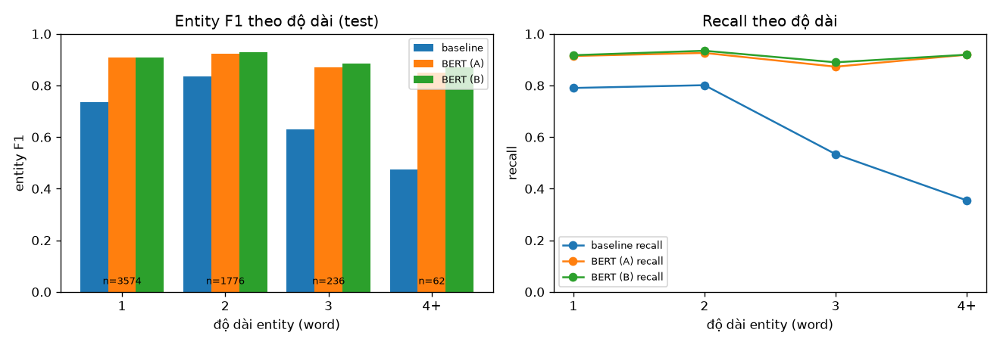

# Reflection — LAB 09

## 1. Kết quả chính (CoNLL-2003 test, 5 648 entity)

| Model | Entity P | Entity R | **Entity F1** | Token acc | Token F1 (≠ O) |
|---|---|---|---|---|---|
| Baseline (word features + Logistic Regression) | 0.742 | 0.778 | **0.760** | 0.958 | 0.814 |
| BERT, Strategy A (subword đầu + IGNORE) | 0.905 | 0.916 | **0.911** | 0.983 | 0.923 |
| BERT, Strategy B (lan truyền I-X) | 0.907 | 0.922 | **0.914** | 0.983 | 0.925 |

Validation entity F1: baseline 0.843, BERT A 0.948, BERT B 0.948.

## 2. Đối chiếu prediction

| Prediction | Dự đoán | Thực tế | Đúng? |
|---|---|---|---|
| P1: Transformer so với baseline | F1 từ 0.75–0.80 lên khoảng 0.90; token accuracy chênh ít; recall tăng nhiều hơn precision | 0.760 → 0.911. Token accuracy chỉ chênh 2.5 điểm (0.958 → 0.983), entity F1 chênh 15 điểm. Precision tăng 16.3 điểm, recall tăng 13.8 điểm | Đúng, trừ ý "recall tăng nhiều hơn" |
| P2: entity dài khó hơn | F1 giảm dần 1 > 2 > 3 > 4+; ngoại lệ có thể ở 2 token | 0.908 / **0.924** / 0.869 / 0.851. Nhóm 2 token cao nhất; từ 3 token trở lên mới giảm | Đúng một phần, đúng cả ngoại lệ |
| P3: entity hiếm gây nhiều lỗi hơn | unseen thấp hơn seen 5–10 điểm (BERT), khoảng 20 điểm (baseline) | BERT: 0.962 so với 0.855 (−10.7). Baseline: 0.914 so với 0.598 (−31.6) | Đúng; baseline giảm mạnh hơn dự đoán |

## 3. Trả lời câu hỏi các experiment

### Exp 1 — Tokenization (`tokenizer_alignment.ipynb`, toàn bộ 3 453 câu test)

| Nhóm | R = #token / #word | % word bị tách |
|---|---|---|
| Toàn tập (46 435 word) | 1.367 | 17.8% |
| Câu ngắn (≤ 9 word) | 1.826 | 34.8% |
| Câu dài (> 9 word) | 1.226 | 12.7% |
| Word thuộc entity | 1.915 | 45.3% |
| Word O | 1.251 | 12.0% |
| PER / ORG / LOC / MISC | 2.06 / 1.94 / 1.78 / 1.73 | 60% / 45% / 31% / 31% |

**Loại từ nào hay bị tách thành nhiều subword?**

- **Tên riêng hiếm,** nhất là tên người nước ngoài ("Shkvyrin" → `S ##h ##k ##vy ##rin`). PER bị tách nhiều nhất (60% word), vì tên người đa dạng hơn tên địa danh và tổ chức.
- **Từ VIẾT HOA TOÀN BỘ:** 87% bị tách, R = 3.35. Vocabulary `cased` có "Japan" nhưng không có "JAPAN" (thành `J ##AP ##AN`). CoNLL có nhiều tiêu đề và bảng kết quả viết hoa, nên câu ngắn (thường là tiêu đề) có R cao hơn hẳn câu dài.
- **Từ có chữ số, URL, số điện thoại, tỉ số:** 34% bị tách, ví dụ "+56-2-699-5595" thành 11 mảnh.
- **Từ dài:** từ 13 ký tự trở lên bị tách 63%. Từ thường chữ thường hiếm khi bị tách (6.7%); khi bị tách thì theo hình thái ("newcomers" → `newcomer ##s`, "unstoppable" → `un ##stop ##pable`).

Tóm lại, word thuộc entity bị tách nhiều gấp gần 4 lần word thường. Vì vậy label alignment là vấn đề trung tâm đúng ở những từ quan trọng nhất cho NER.

### Alignment — chọn Strategy A, so sánh với B

- **Chọn A** (subword đầu nhận nhãn của word, subword sau là IGNORE):
  - Annotation gốc là theo word, nên mỗi word chỉ cần một quyết định. Không phải tự đặt ra nhãn cho `##` (`##X` của "SpaceX" là B hay I?).
  - Đánh giá ở mức word khớp trực tiếp với gold.
  - Loss tính trên 67.7% token; 32.3% còn lại là `[CLS]`, `[SEP]` và các subword sau mảnh đầu. Các token này vẫn đi qua Transformer và vẫn được attend tới.
- **Ảnh hưởng (train thêm B với cùng cấu hình):**
  - B có loss trên 90.7% token. Validation F1 gần như bằng nhau (0.9481 so với 0.9484).
  - Trên test, B cao hơn một chút (0.914 so với 0.911), chủ yếu ở recall (0.922 so với 0.916) và ở entity unseen (0.861 so với 0.855).
  - Có thể vì B cho thêm tín hiệu học ở các mảnh `##` của tên lạ. Nhưng chênh lệch 0.4 điểm, chỉ 1 seed, nên chưa đủ để kết luận B tốt hơn.
  - Với cách đánh giá theo subword đầu, A đơn giản và nhất quán hơn. Còn B làm phát sinh câu hỏi: nếu `Space` là B-ORG mà `##X` lại đoán O thì sao?

### Exp 2 — Baseline vs Transformer

Xem bảng mục 1, cùng test set. Baseline mạnh ở entity đã gặp (recall 0.981 với entity xuất hiện > 10 lần trong train, bằng BERT) nhưng sụp ở entity chưa gặp (0.628). Tức là baseline chủ yếu **nhớ** tên, còn BERT **suy ra** được từ ngữ cảnh và hình thái.

### Exp 3 — Token-level vs entity-level

- Ví dụ của đề: gold `New York → B-LOC I-LOC`, dự đoán `B-LOC O`. Token accuracy 0.50 nhưng entity P = R = F1 = 0.
- Trên test:
  - Baseline có token accuracy 0.958 nhưng entity F1 chỉ 0.760. Trong 1 252 entity baseline làm sai, 25% vẫn có ít nhất một token đúng nhãn, tức token-level vẫn "cho điểm".
  - Với BERT, con số này là 18% (85 trên 472).
- Token accuracy bị thổi phồng vì 83% word là O. Một model đoán toàn O đã có accuracy khoảng 0.83 mà entity F1 bằng 0.

### Exp 4 — Theo loại entity (BERT A, test)

| Entity | Precision | Recall | F1 | Support test | Entity train | Baseline F1 |
|---|---|---|---|---|---|---|
| PER | 0.965 | 0.952 | **0.959** | 1 617 | 6 600 | 0.809 |
| LOC | 0.930 | 0.928 | 0.929 | 1 668 | 7 140 | 0.834 |
| ORG | 0.875 | 0.912 | 0.893 | 1 661 | 6 321 | 0.644 |
| MISC | 0.789 | 0.816 | **0.803** | 702 | 3 438 | 0.739 |

**Vì sao các loại khác nhau?**

- **Số lượng training examples:** MISC ít nhất (3 438, khoảng một nửa các loại khác) và có F1 thấp nhất. Nhưng số lượng không giải thích hết: ORG có số mẫu gần bằng PER mà thấp hơn 6.5 điểm.
- **Lexical patterns:**
  - PER có mẫu rõ nhất: hai từ viết hoa (tên + họ), thường đi với "said", "Mr". Nhóm 2 token chủ yếu là PER (1 018 / 1 776), nên đó cũng là lý do nhóm 2 token có F1 cao nhất.
  - MISC là nhóm "còn lại": quốc tịch, sự kiện, giải đấu, tên sản phẩm. Không có mẫu chung.
- **Ambiguity:** ORG và LOC chia nhau cùng một tập tên: thành phố cũng là tên đội ("Chicago", "Barcelona"), tên quốc gia cũng là đội tuyển. 47 LOC bị đoán thành ORG và 35 ORG thành LOC.
- **Context:** để phân biệt đội và thành phố, cần ngữ cảnh ("at Chicago" so với "Chicago 0 0"). Bảng kết quả thể thao thường không có ngữ cảnh đó.
- **Entity boundary:** ORG và MISC dài hơn (ORG chiếm 54 / 62 entity từ 4 token trở lên) và chứa từ thường ("Association", "Classic", "Cup"), nên dễ sai biên.
- **Domain:** CoNLL là tin Reuters 1996, nhiều tin thể thao. Tên đội thể thao (ORG) xuất hiện dày đặc ở dạng bảng, chỗ model yếu nhất.
- **Precision ORG thấp nhất trong các loại lớn (0.875):** 49 span spurious bị đoán là ORG, và nhiều loại khác bị kéo về ORG. ORG là nhãn "mặc định" khi model không chắc.

### Exp 5 — Theo độ dài entity

| Độ dài (word) | Support | Baseline F1 | BERT A F1 | BERT B F1 |
|---|---|---|---|---|
| 1 | 3 574 | 0.737 | 0.908 | 0.909 |
| 2 | 1 776 | 0.835 | **0.924** | 0.930 |
| 3 | 236 | 0.630 | 0.869 | 0.886 |
| 4+ | 62 | 0.473 | 0.851 | 0.870 |

- **Với cả hai model, entity từ 3 word trở lên khó hơn rõ rệt:** BERT giảm 5–7 điểm F1 so với nhóm 2 word. Nhưng nguyên nhân ở hai model khác nhau:
  - **BERT:** recall gần như không đổi theo độ dài (khoảng 0.87–0.93, nhóm 4+ là 0.92). Entity dài thật vẫn được tìm ra đủ. F1 giảm vì **precision**: model sinh thêm các span dài sai, như gộp hai entity sát nhau ("Barcelona Real Madrid") hoặc kéo dài sang từ thường bên cạnh.
  - **Baseline:** recall sụp từ 0.80 (2 word) xuống 0.53 (3 word) và 0.35 (4+ word). Nó dự đoán từng token độc lập, không biết token trước đó đã mở entity, nên hay cắt entity dài ở các từ thường ("of", "Cup", "Classic").
- Như vậy Prediction 2 đúng với baseline. Với BERT, "khó" thể hiện ở việc đặt biên quá rộng hơn là bỏ sót phần entity: self-attention thấy cả câu, nên biên ổn định hơn nhiều.
- **Nhóm 1 word không phải dễ nhất.** Nó chứa nhiều từ mơ hồ nhất: tên thành phố / đội, quốc tịch, từ viết hoa trong tiêu đề. Nhóm 2 word chủ yếu là tên người (họ + tên), loại dễ nhất.
- **Strategy B tốt hơn A rõ nhất ở entity dài** (3 word: 0.886 so với 0.869). Có thể vì B dạy model rằng các mảnh `##` vẫn thuộc entity, giúp biên liền mạch hơn. Tuy vậy nhóm 4+ chỉ có 62 entity, nên chênh lệch nhỏ không chắc chắn.

### Information Extraction (Option A — News, `information_extraction.py`)

Ví dụ: "Barack Obama visited Paris on Monday." → `{"PERSON": ["Barack Obama"], "LOCATION": ["Paris"]}`.

Đánh giá trên 30 câu tin tức tự viết, 76 entity gold:

| | P | R | F1 |
|---|---|---|---|
| Tất cả | 0.935 | 0.947 | **0.941** |
| PER / ORG / LOC / MISC | 0.929 / 0.955 / 0.923 / 0.933 | 0.867 / 0.955 / 1.000 / 0.933 | 0.897 / 0.955 / 0.960 / 0.933 |

4 câu có lỗi:

- **"King Abdullah":** gộp chức danh vào tên. Gold theo quy ước CoNLL chỉ là "Abdullah".
- **"Berlin Marathon":** tách thành Berlin (LOC) + Marathon (MISC).
- **"Kremlin":** đoán LOC thay vì ORG, vì cơ quan được gọi bằng tên địa điểm.
- **"Elon Musk" → ORG:** lỗi thú vị nhất. Có thể vì "Musk" bị tách `Mu ##sk` và tên này không có trong tin năm 1996, cộng với "Tesla" ngay sau đó là ORG.

Lưu ý: các câu này do mình viết và gán nhãn, nên có thể dễ hơn tin thật. Không có câu viết hoa toàn bộ hay bảng điểm.

## 4. Individual learning check

1. **Sequence classification khác token classification thế nào?** Sequence classification cho một nhãn cho cả chuỗi (đọc vector [CLS]). Token classification cho một nhãn cho **mỗi** token (đọc mọi hidden state). Output là T nhãn thay vì 1.
2. **BIO tagging dùng để làm gì?** Mã hóa cả **loại** lẫn **biên** của entity vào nhãn của từng token. Nhờ vậy dựng lại được chính xác các span từ chuỗi nhãn.
3. **B-PER khác I-PER thế nào?** B-PER mở một entity PER mới. I-PER nối tiếp entity PER đang mở. "Elon Musk" là `B-PER I-PER` (1 entity); `B-PER B-PER` sẽ là 2 entity.
4. **Vì sao tokenizer gây ra label alignment problem?** Nhãn được gán theo word, còn model nhận subword. Một word có thể thành nhiều token ("Musk" → `Mu ##sk`), và có thêm token không thuộc word nào (`[CLS]`, `[SEP]`, `[PAD]`). Số nhãn và số token không còn khớp nhau.
5. **IGNORE trong loss nghĩa là gì?** Vị trí có nhãn −100 không được tính vào cross-entropy. Token đó vẫn đi qua model và vẫn ảnh hưởng tới token khác qua attention; chỉ là dự đoán ở vị trí đó không bị chấm điểm.
6. **Vì sao không nên chỉ dùng token accuracy?** 83% word là O, nên model đoán toàn O vẫn có accuracy khoảng 0.83. Token accuracy còn cho điểm entity bị cắt dở: baseline có 0.958 accuracy nhưng chỉ 0.760 entity F1.
7. **Entity-level F1 khác token-level F1 thế nào?**
   - Token-level đếm từng token đúng nhãn.
   - Entity-level đếm span: một entity chỉ là TP khi khớp đúng cả biên trái, biên phải và loại. Sai một token là mất cả entity, và còn sinh thêm một FP.
8. **Vì sao entity boundary khó?** Entity chứa từ thường ("University **of** California", "**West** Indies", "**1966** World Cup"). Quy ước gán nhãn không trực quan (chức danh "Pope" không thuộc entity, nhưng "Saint Nicholas" thì có). Hai entity cùng loại đứng sát nhau ("Barcelona Real Madrid") chỉ phân biệt được bằng một nhãn B.
9. **Vì sao contextual representation hữu ích cho NER?** Loại entity phụ thuộc ngữ cảnh: "American" là hãng bay hay quốc tịch, "Chicago" là đội hay thành phố. Vector contextual của cùng một từ thay đổi theo câu. Trên 367 lần xuất hiện của từ mơ hồ, BERT đúng 86.1%, baseline 65.4%.
10. **NER dùng thế nào trong Information Extraction?** NER là bước đầu: biến văn bản tự do thành danh sách entity có loại (JSON). Từ đó có thể tìm quan hệ giữa các entity (ai làm việc ở đâu), điền vào cơ sở dữ liệu, hoặc lọc và tìm kiếm tin tức theo người / tổ chức.

## 5. Reflection — Vì sao cùng một pretrained Transformer dùng được cho cả sequence và token classification chỉ bằng cách đổi head?

Ở LAB 08, mình dùng DistilBERT để phân loại sentiment: lấy vector của `[CLS]` rồi đưa qua một lớp Linear thành 2 logit. Ở LAB 09, mình dùng BERT cho NER: lấy vector của **mọi** token rồi đưa qua một lớp Linear thành 9 logit mỗi token. Phần ở giữa, tức 12 layer Transformer với khoảng 108 triệu tham số, giống hệt nhau. Head chỉ có 6 921 tham số (768 × 9 + 9), chưa tới 0.01% model.

Điều này làm được vì pretrained Transformer không học "sentiment" hay "entity". Nó học một **contextual representation** cho từng token: ma trận H kích thước T × 768, trong đó vector của mỗi token đã chứa thông tin về chính nó và về cả câu (qua self-attention). Pretraining bằng MLM buộc mỗi vị trí phải biết đủ về ngữ cảnh để đoán được từ bị che. Thông tin đó vừa đủ để biết "American" sau "British Airways and" là một hãng bay, vừa đủ để biết cả review là khen hay chê.

Cái khác nhau giữa hai task chỉ là **đọc H ở đâu** và **định nghĩa output thế nào**:

- **Sequence classification** chỉ đọc một vị trí (`[CLS]`), vì cần một nhãn cho cả chuỗi. Fine-tuning dạy vector `[CLS]` gom thông tin của cả câu.
- **Token classification** đọc mọi vị trí, vì cần một nhãn cho mỗi token. Cùng một Linear được áp lên từng hàng của H: Z = HW + b. Loss là trung bình trên các token có nhãn, bỏ qua IGNORE.

Vì vậy, đổi task chủ yếu là đổi **cách định nghĩa label**, chứ không phải đổi kiến trúc. Ở NER, phần khó nhất của lab không nằm ở model mà ở dữ liệu:

- chuyển annotation theo word sang token (alignment, IGNORE);
- mã hóa biên bằng BIO;
- đánh giá ở mức entity chứ không phải token.

Kết quả cũng cho thấy giới hạn của "chỉ đổi head". Model biết ngữ cảnh rất tốt, nhưng lỗi còn lại đến từ những chỗ ngữ cảnh không có (bảng điểm, tiêu đề viết hoa), từ tokenizer cố định (từ viết hoa toàn bộ bị tách vụn 87%), và từ quy ước gán nhãn. Head tuyến tính cũng dự đoán từng token độc lập, nên vẫn có thể sinh chuỗi BIO lạ. Một lớp CRF phía trên có thể ràng buộc chuyển nhãn hợp lệ.

## 6. Bridge to LAB 10

NER trả lời "trong văn bản có những entity nào". Question Answering trả lời "**đoạn nào** trong văn bản trả lời câu hỏi này". Đầu vào là cặp `[CLS] question [SEP] context [SEP]`. Vẫn backbone đó, vẫn H, nhưng head đổi thành hai vector: tính Pstart và Pend cho mỗi token rồi lấy span. Vấn đề alignment của LAB 09 vẫn còn, ở dạng mới: vị trí ký tự của câu trả lời phải được ánh xạ sang vị trí token, và context dài hơn 512 token phải được cắt thành nhiều đoạn.
